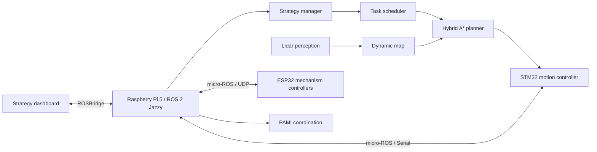

# EUROBOT 2026 — ROS 2 Workspace

ROS 2 workspace for AEROBOTIX INSAT's autonomous EUROBOT 2026 robot. The system coordinates strategy execution, Hybrid A* navigation, lidar-aware map updates, Raspberry Pi orchestration, and micro-ROS communication with STM32 and ESP32 controllers.

## Competition result

- 1st place — Tunisian qualifications
- 2nd place — international accumulation phase
- 5th place overall — EUROBOT 2026 Finals, France

[Watch the robot demo](https://www.youtube.com/watch?v=EC6gGIbOj7o&list=PLNhKoU2ZKSAGotMFKrfqBCY1hgt4LfQE8)

## System overview



The high-level stack runs on a Raspberry Pi 5. ROS 2 nodes make strategy and navigation decisions while embedded controllers execute time-sensitive motion and mechanism commands.

## Workspace packages

| Package | Responsibility |
|---|---|
| `euro` | Strategy management, task scheduling, controller orchestration, PAMI coordination, and embedded-agent startup |
| `hybrid_astar` | Kinematically aware path planning, dynamic-map updates, and path-computation services |
| `aruco_mapper_msgs` | Messages and services for tracks, batches, and stable ArUco observations |
| `rviz` | Robot model, competition maps, RViz configuration, and pose visualization |
| `service` | Navigation-to-STM32 service interfaces |

## Key capabilities

- Strategy loading and execution from YAML task definitions
- Hybrid A* path planning on the competition map
- Dynamic obstacle and map updates
- Lidar-informed navigation and avoidance
- STM32 and ESP32 communication through micro-ROS agents
- Front, back, pneumatic, and PAMI subsystem coordination
- RViz robot-state and map visualization
- ROSBridge integration with the separate operator dashboard

## Requirements

- Ubuntu 24.04
- ROS 2 Jazzy
- Python 3.10+
- `colcon` and `rosdep`
- The connected micro-ROS agents and hardware only for physical-robot operation

## Build

```bash
git clone https://github.com/Eurobot-2026-Aerobotix/ROS2-WS-EURO.git
cd ROS2-WS-EURO

source /opt/ros/jazzy/setup.bash
rosdep install --from-paths src --ignore-src -r -y
colcon build --symlink-install
source install/setup.bash
```

## Run the navigation stack

Launch Hybrid A* with its default configuration:

```bash
ros2 launch hybrid_astar hybrid_astar.launch.py
```

Useful executables include:

```bash
ros2 run hybrid_astar hybrid_astar_node
ros2 run euro strategy_manager
ros2 run euro stm32_agent
ros2 run euro esp32_agents
ros2 run euro pami_controller
```

Exact serial devices, network addresses, team color, and task configuration depend on the robot deployment. Review the YAML files under `src/euro/config` and `src/hybrid_astar/config` before running against hardware.

## Repository layout

```text
ROS2-WS-EURO/
└── src/
    ├── aruco_mapper_msgs/   # ArUco mapping interfaces
    ├── euro/                # Strategy and robot orchestration
    ├── hybrid_astar/        # Navigation and path planning
    ├── rviz/                # Maps, URDF, and visualization
    └── service/             # Embedded navigation service
```

## Operator dashboard

The web dashboard for strategy selection, simulation, monitoring, and telemetry is maintained separately in [Eurobot_Dashboard](https://github.com/Eurobot-2026-Aerobotix/Eurobot_Dashboard).

## Safety

This repository controls physical hardware. Before enabling actuators:

1. Verify the emergency-stop path.
2. Test with the drive wheels lifted.
3. Confirm serial ports, network targets, and team-color configuration.
4. Validate navigation in simulation or RViz.
5. Keep a human operator within reach of power isolation.

## Team and attribution

Built collaboratively by AEROBOTIX INSAT for EUROBOT 2026. Consult the repository history for individual contributions to navigation, strategy, embedded communication, perception, mechanisms, and operations.

## License

Package-level license declarations apply. Confirm reuse terms with AEROBOTIX INSAT before redistributing the complete competition workspace.
